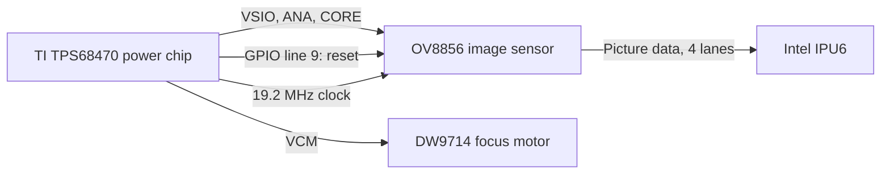

# How I got the Dell Latitude 7320 Detachable's rear camera working on Linux

*Last updated: November 20, 2026*

> **At a glance**
> - **What:** Rear camera support for the Dell Latitude 7320 Detachable on Linux
> - **When:** October–November 2026
> - **Result:** The camera takes photos and video. Two driver fixes are in review on linux-media (version 2). A third was turned down, and "What went upstream" explains why.
> - **How:** Control tests, kernel tracing, and a logged record of about 90 steps, working with Claude Opus 5.5 as a tool
> - **Links:** [GitHub repo](https://github.com/babisdanias/latitude-7320-rear-camera) · [Patches on lore.kernel.org](https://lore.kernel.org/r/20261116-ov8856-pm-fixes-v2-0-7e41763164f2@tutamail.com)

The Dell Latitude 7320 Detachable is a Windows tablet with two cameras. On Linux, neither of them worked.

In October and November 2026, I worked out how the rear camera gets its power, proved each value with a control test, and got it to take pictures on Fedora. On the way, I found two bugs in the Linux driver for its image sensor and tracked down the cause of a third, a sleep bug others had already reported. My fixes for the first two are in review on linux-media, the kernel's mailing list for camera and video drivers.

## The problem

Many laptop cameras are simple USB devices, and Linux drives them with no extra work. This tablet uses a harder kind: camera modules wired straight to Intel's image unit (IPU6), fed by a power chip, the TI TPS68470.

That power chip is the catch. It has seven power lines, called rails, and a set of control pins. The firmware doesn't say which rail or pin goes to which camera.

So Linux needs a small table for each tablet model, called board data. In August 2026, Sahan Nissanka posted that table for the front camera. For the rear camera, his notes had only an unverified report of the reset pin.

A wrong pin can usually be undone. A wrong voltage can burn the sensor for good. So guessing was not an option.

## How I worked

I set four rules at the start and kept to them. Where I slipped, the log says so:

- Read before you change anything. Nothing touched the camera hardware until I had read the firmware tables, the kernel log, and the driver code.
- Use no voltage without evidence. Every value had to come from the firmware, Sahan's patch, a datasheet, or kernel code, and I wrote down which.
- Always keep a way back. A known-good Fedora kernel stayed installed, and a reboot removed every test module.
- Log every step as it happens, mistakes included. Each entry in [`LOG.md`](https://github.com/babisdanias/latitude-7320-rear-camera/blob/HEAD/LOG.md) holds the commands I ran, what came back, and what I made of it. The log now holds about 90 steps.

Kernel work was out of my depth, so I worked with Claude Opus 5.5. It helped me with the kernel code, the steps, and the writing drafts. I did the hands-on work on the tablet, made the decisions, decided what to document and what to keep, and edited the drafts before anything went out.

## What I found

### The firmware knew where the camera was, but not how to power it

The firmware's hardware tables (ACPI) turned out to be templates. The real values sit in a 2,748-byte block of firmware memory. To read it, I turned off the boot loader's Secure Boot checks and, for a single start-up, added a kernel option.

The block gave me the rear camera's bus, address, data lanes, and clock. It also showed a focus motor, a Dongwoon DW9714. It held no pins and no voltages.

### Windows files and datasheets narrowed the search

Dell's Windows camera driver has settings files for this rear module. I read its two setup files in full, and they hold no power data. That data most likely sits in the compiled drivers, and I left it there: maintainers may reject values copied from closed code.

Instead, I checked the voltages against the chip datasheets. If Dell wired the board the standard way, the sensor and the focus motor would each get a voltage inside their safe range. That made a test safe enough to try, but it didn't prove the wiring.

### The driver skipped power on this kind of machine

The kernel code showed a second problem. On machines described by ACPI, the `ov8856` sensor driver skipped its whole power-up sequence and left power to the firmware. On this tablet, the firmware doesn't do it.

So board data alone could never wake the rear camera. I changed the driver to run the sequence. Later I found that Serin Yeh had already sent the same change upstream, and it's now part of Linux 7.4-rc1.

### One step at a time

I switched the rails on in small steps, with the kernel tracing every power event:

1. No rails at all, to check the driver's reset and clock sequence. No camera rail switched on, as planned.
2. Only the three rails the front camera already uses, at the same voltages. That added no new electrical state. The sensor stayed silent, but a chip on the rear module, most likely its calibration memory, answered. The module's input and output side was alive.
3. The standard setup: the three rails the power chip's maker meant for a camera sensor, one each for its input/output, analog, and core power. The sensor answered, and for the first time on my tablet, Linux talked to it.

That third step was the one real risk in the project. If Dell had wired the 2.8 V analog rail to a pin built for less, it could have damaged the sensor. I took that risk on five pieces of evidence, not on a schematic:

- The power chip's datasheet names each rail's job.
- Microsoft's Surface Go uses the same chip, set up the same way.
- The kernel's data for another Dell tablet uses the same rails and voltages for its second camera.
- Every voltage sits inside the sensor's safe range.
- In the second step, part of the rear module already woke up on the input/output rail.

The first picture was dark, noisy, and green. But it was a real picture.

### Proving each piece

A working camera doesn't prove that the board data is right. A reset pin that's already released would look fine too. So I tested each value against a control.

The diagram shows what powers the rear camera. The table after it shows how I know.

| Part | Rail or pin | Evidence |
| --- | --- | --- |
| Sensor | VSIO 1.8006 V, ANA 2.8152 V, CORE 1.2 V | Silent with only the front camera's rails on. Answers with these three on. Each voltage is inside the sensor's safe range. |
| Sensor reset | Power chip GPIO line 9 (`s_resetn`), active low | Held low: silent, three times out of three. Held high: answers, three times out of three. Holding the front camera's reset pin low changes nothing. |
| Focus motor | VCM 2.8152 V | Silent with every other rail switched on. Answers once VCM is on. Inside the motor's safe range. |

The voltages are the ones Sahan's board data already set. I didn't choose a single new value.

The lens moves too. At three lens positions, the pictures went from sharp to blurry. I could see it by eye, and a simple sharpness measure agreed.

### Three power bugs

Once the driver really controlled the power, three bugs came out. I found the first two. Sahan and Charles had already reported the third, and I traced its cause.

1. Detaching the driver from the sensor switched off power that was already off. The kernel warned, and on this tablet the extra switch-off could also stop the clock that the front camera shares.
2. The driver told the camera system that the sensor was there before the sensor could be woken. If the camera system tried to wake it in that short gap, it got error `-13` and gave up on the focus motor. Whether that happens depends on which side gets there first: it hit every bind in my test setup, and about one boot in four on Charles Drolet's tablet.
3. When the focus motor's driver was loaded, the sensor stayed switched on while the tablet slept, with no app using the camera. That wastes battery. In my test, the tablet slept for 21 seconds, and the sensor was on the whole time.

The first two bugs are years old. The first stayed hidden because the driver never touched the power on these machines, and the second depends on timing. The third arrived with the power change itself.

## What went upstream

On November 4, 2026, I sent three patches, one for each bug. A patch is a code change, sent by email for review. Each new round of a patch gets a version number, so this first round was version 1. Each patch built with extra compiler warnings on (`W=1`) and gave none. Each one passed the kernel's style checker, `checkpatch.pl --strict`, with no complaints.

I tested them on the tablet on two kernels. The emails said plainly how an AI assistant had helped, as the kernel's rules ask.

Review changed the series:

- Sakari Ailus, who maintains the camera sensor drivers, asked for changes to how patches 1 and 2 work.
- Laurent Pinchart turned down patch 3. It brought back sleep handlers that he had taken out of the driver on purpose in 2023. The sleep bug is still real, and Charles Drolet is working on a different fix, in the focus motor's driver.

On November 16, I sent version 2: the first two patches, reworked as Sakari asked, and tested again on Linux 7.2.15 and a 7.4-rc2 snapshot. Before I sent it, I checked that the code in the emails was byte for byte the code I had tested. It's now waiting for the next round of review.

## What isn't done yet

- The rear camera's board data isn't upstream yet. Charles Drolet is handling that part, and I'll test his version against mine.
- The sleep bug waits for Charles's fix.
- Picture quality is poor. On Fedora, libcamera turns the raw sensor data into a picture in software, with no tuning for this sensor and no autofocus. On Windows, Intel's image processor uses a tuning file made for this exact module.
- On Linux 7.2.15, about two in three stream starts log errors in the camera receiver, though every frame still arrived in my 10-frame test runs. My runs on the 7.4 kernels showed none, but that's too few runs to call it fixed.

## Lessons learned

What worked:

- A guard in my edit scripts. They wrote nothing unless every target line matched, and that stopped one bad edit.
- Reading the diff after every hand edit. In the v2 work, it caught every slip my eyes had missed.

Next time, I'd do four things differently:

- Get a schematic, a measurement, or sign-off before switching on rails on hardware that isn't mine. On my own tablet, I took that risk knowingly, after checking every voltage against the datasheets.
- Search the mailing list before writing a fix. Serin Yeh had sent the same ACPI power change in August, before I even started.
- Check where each bug started before naming its source in a patch. In the first version, one patch named the wrong older change.
- Read why a past change was made before undoing it. Patch 3 passed every test on my tablet, but it brought back sleep handlers a maintainer had removed on purpose in 2023. That commit was already in my notes, but I didn't act on why it was made.

## Credits

This work stands on other people's:

- Sahan Nissanka wrote the power chip's board data for this tablet and the front-camera series that everything here builds on.
- Charles Drolet reported the rear reset pin, shared details from the power chip's datasheet, and tested patch 2 on his own tablet.
- Serin Yeh's change taught the `ov8856` driver to handle power on ACPI machines.
- Sakari Ailus and Laurent Pinchart reviewed the series.

## Read more

- [The full investigation log, with every command and its result](https://github.com/babisdanias/latitude-7320-rear-camera/blob/HEAD/LOG.md)
- [Version 2 of the patch series on lore.kernel.org](https://lore.kernel.org/r/20261116-ov8856-pm-fixes-v2-0-7e41763164f2@tutamail.com)
- [Version 1 of the patch series, with its review](https://lore.kernel.org/r/20261104-ov8856-pm-fixes-v1-0-1958b730ce66@tutamail.com)
- [Sahan's front-camera work and notes for this tablet](https://github.com/githomeserver/latitude-7320-camera)
- [Intel ipu6-drivers issue #24 on GitHub](https://github.com/intel/ipu6-drivers/issues/24)
- [Intel ipu6-drivers issue #402 on GitHub](https://github.com/intel/ipu6-drivers/issues/402)
